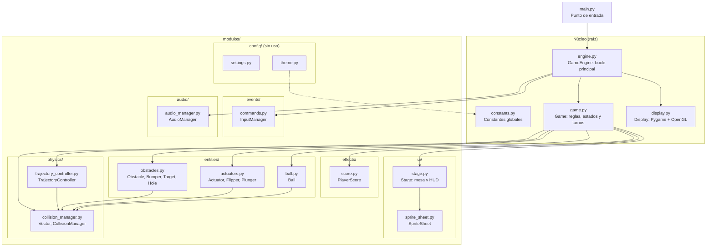
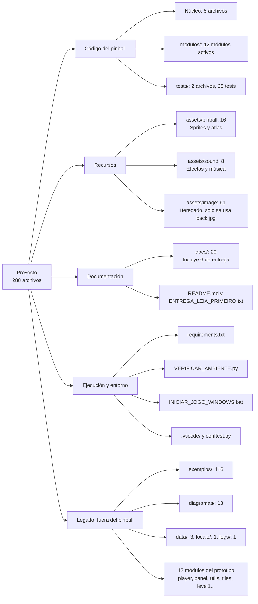

# Resumen de archivos y módulos del pinball

Resumen generado a partir de los archivos y las importaciones reales del proyecto. Tiene **288 archivos**, y el pinball funciona con **17 módulos Python**, de los cuales 15 están conectados al juego.

## Módulos del pinball y sus dependencias

`constants.py` también lo usan `engine`, `game`, `display`, `stage`, `score`, `ball` y `trajectory_controller`. Esas flechas se omiten para que el diagrama se pueda leer.

## Organización de los archivos

## Puntos a limpiar

- **`modulos/config/` no está conectado:** ningún módulo activo importa `settings.py` ni `theme.py`, así que cambiar esas opciones no afecta al juego.
- **El código legado ya no funciona:** varios de esos módulos importan rutas como `modulos.constants` y `modulos.game`, que ya no existen. El pinball no los usa, así que hoy no causan fallos.
